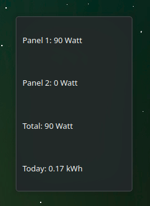

<div align="center">
  
  <h1>EZMonitor</h1>
  <a href="https://kde.org/de/">
    
  </a>
  <a href="https://www.gnu.org/licenses/gpl-3.0.html">
    
  </a>
  <a href="https://build.opensuse.org/package/show/home:Agundur/EZMonitor">
    
  </a>
  <a href="https://paypal.me/agundur">
    
  </a>
</div>

## Description

EZMonitor is a lightweight KDE Plasma 6 widget that displays real-time data
from your solar inverter.

Developed for the APsystems EZ1 microinverter series, it connects to the
local JSON API provided by the device and shows:
- Live panel power (in Watts)
- Daily yield (in kWh)
- Updates every 10 seconds

No cloud service, no third-party backend – all data stays local.

## Features

- Built with pure QML – no C++ or Python dependencies
- Compatible with Plasma 6
- Uses standard HTTP API (see: [APsystems EZ1 API Manual](https://forum.iobroker.net/assets/uploads/files/1701255814508-apsystems-ez1-local-api-user-manual.pdf))
- Clean UI for live monitoring

## Visuals



## Install

Easiest: **"Get New Widgets"** in System Settings, or grab the `.plasmoid`
from the [latest release](https://github.com/Agundur-KDE/EZMonitor/releases/latest)
and:
```bash
kpackagetool6 --type Plasma/Applet --install ezmonitor-*.plasmoid
```

Also available as a proper package, if you'd rather have `zypper`/`apt`
manage updates:
```bash
# openSUSE Tumbleweed
sudo zypper ar -f https://download.opensuse.org/repositories/home:/Agundur/openSUSE_Tumbleweed/home:Agundur.repo
sudo zypper --gpg-auto-import-keys ref
sudo zypper in ezmonitor

# Debian/Ubuntu — grab the .deb from the latest release above
```

Or straight from source, no build step needed:
```bash
git clone https://github.com/Agundur-KDE/EZMonitor.git
kpackagetool6 --type Plasma/Applet --install EZMonitor/package/
```

## Usage

Enable the local API of your APsystems EZ1-M, then add the plasmoid to
your desktop and enjoy.

## Tested Hardware

EZMonitor has been tested successfully with the following micro inverter:

🛒 [APSystems EZ1-M Micro Inverter](https://amzn.to/4jGRqBY) (Affiliate link)

This inverter is fully supported by EZMonitor and has been used in daily
production environments.

Using the link above helps support further development of EZMonitor, at
no additional cost to you.

## Support

Open an issue: [EZMonitor Issues](https://github.com/Agundur-KDE/EZMonitor/issues)

## Contributing

Fork and adapt freely.

## License

GPL-3.0-or-later
